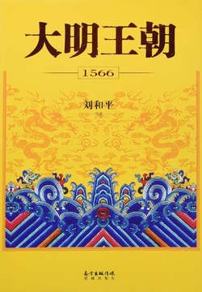

# 元数据

| 项目 | 内容 |
|------|------|
| 书名 | 大明王朝1566（全集） |
| 作者 | 刘和平 |
| 出版时间 | 2016-07-01 00:00:00 |
| ISBN | 9787536079113 |
| 分类 | 历史-历史小说 |
| 出版社 | 花城出版社 |

## 简介

豆瓣9.5分高评好剧《大明王朝1566》同名小说，新加坡内阁政治参考书。此书为《雍正王朝》编剧、《北平无战事》作者刘和平成名之作。全书以扳倒大老虎严嵩为线索，讲述大明王朝一场盘根错节、惊心动魄的反腐大戏。揭开中国历史上最另类的皇帝嘉靖数十年不上朝的执政之谜；揭示中国历史上清官海瑞以“智忠”代“愚忠”的为官之道；揭露清修明史列为奸臣之最首辅严嵩权极而衰的真相；揭破明朝特殊的政治机构宦官集团最深层的秘密。时隔十年，该剧于2017年2月13日在优酷上线重播。

---
