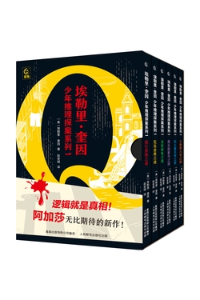

# 元数据

| 项目 | 内容 |
|------|------|
| 书名 | 埃勒里·奎因 少年推理探案系列1 |
| 作者 | [美]埃勒里·奎因 |
| 出版时间 | 2025-04-01 00:00:00 |
| ISBN | 9787115651945 |
| 分类 | 精品小说-悬疑推理 |
| 出版社 | 人民邮电出版社有限公司 |

## 简介

《埃勒里·奎因 少年推理探案系列1》全套共6册，是美国推理小说大师、逻辑之王埃勒里·奎因专门为9岁以上的孩子创作的逻辑推理小说，主角是两位少年侦探。每本书围绕一个以动物为线索的谜案展开，将离奇案件与少年的日常生活巧妙结合，情节扑朔迷离，悬念迭起，全程引人入胜，通过抽丝剥茧的逻辑推理，用逻辑还原真相！这套书不仅仅是一套推理书，更是一把开启孩子思维大门的金钥匙！让他们在逻辑、智慧与惊喜中成长！

---
